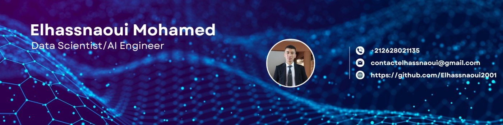
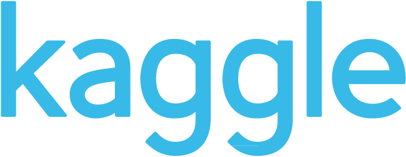
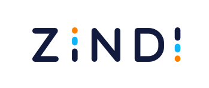
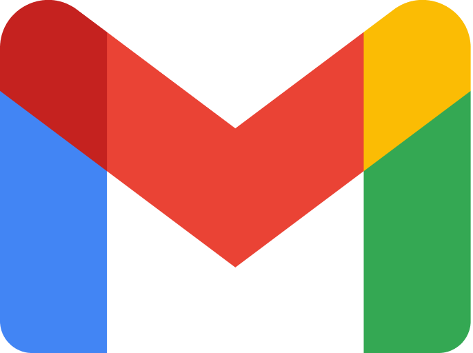

# 

---
# 👋 Hi there, I'm Mohamed Elhassnaoui

🎓 **| Data Scientist | AI Instructor**  
💡 Passionate about Generative AI, Cloud Computing, and Human-Centered Innovation

---

# 👨‍💻 About Me

I'm a Data Scientist and Ph.D. student at the Faculty of Sciences of Rabat, deeply interested in making **AI more inclusive, creative, and accessible**.

- 🔭 Currently building AI agents powered by LLMs on **Azure Cloud**
- 🎨 Working on sign language recognition, Generative AI, and AI for social good
- 🧠 Contributor to open-source tools around GitHub automation and agent workflows
- 📊 Experience in NLP, Deep Learning, OCR, and Business Intelligence
- 🌍 Hackathon enthusiast & AI instructor helping others master prompt engineering

---

# 🚀 Featured Projects

| Project | Description | Tech |
|--------|-------------|------|
| 🤖 **DeepSeek-Azure Agent** | End-to-end agent system that reads, fixes & commits code to GitHub using LLMs | Python · Azure · GitHub API |
| 🧠 **Sign Language Recognition** | Deep learning model with ResNet + Attention for sign language classification | PyTorch · CNN · Attention |
| 📽️ **PlotDot (with ThinkableAI)** | AI script generator for storytelling, fine-tuned on LLaMA & Mistral | LangChain · GPT · Slack Bot |
| 🏥 **AI for Health (Omdena)** | Agent-based RAG pipeline for health education in underserved regions | RAG · Claude · Streamlit |
| 📊 **Power BI Dashboards** | Interactive dashboards for public datasets & business KPIs | Power BI · SQL · DAX |

---

# 🌐 Socials:

---

# 💻 Tech Stack:

---

### 🔧 **Development Languages:**
    

---

### 📊 **Data Science & Machine Learning:**
     

---

### 🖥️ **Data Engineering & Databases:**
 

---

### 📈 **Business Intelligence & Analytics:**

---

### 🌐 **Web & Cloud Development:**
   

---

### 🛠️ **Version Control & Automation:**
 

---

# 📊 GitHub Stats:
 
 

---

## 🏆 GitHub Trophies

---

### ✍️ Day Quote

---

# 📄 Download My CV

Want to know more about my journey? Choose the version that suits you:

- [Download CV (French)](./Cv/Cv_Elhassnaoui_Mohamed-fr.pdf)
- [Download CV (English)](./Cv_Elhassnaoui_Mohamed-en.pdf)

---

## 📫 Let's Connect!

- 📧 **contactelhassnaoui@gmail.com**
- 💼 [LinkedIn](https://www.linkedin.com/in/mohamed-elhassnaoui/)
- 🌐 [Portfolio Website](https://elhassnaoui.com) *(if you want one, I can help you create it!)*
- 🤝 Always open to collaboration on AI4Good, LLMs, or open source!

---

⭐️ *Feel free to explore my pinned projects below — and don’t forget to drop a star if you find something cool!*  
